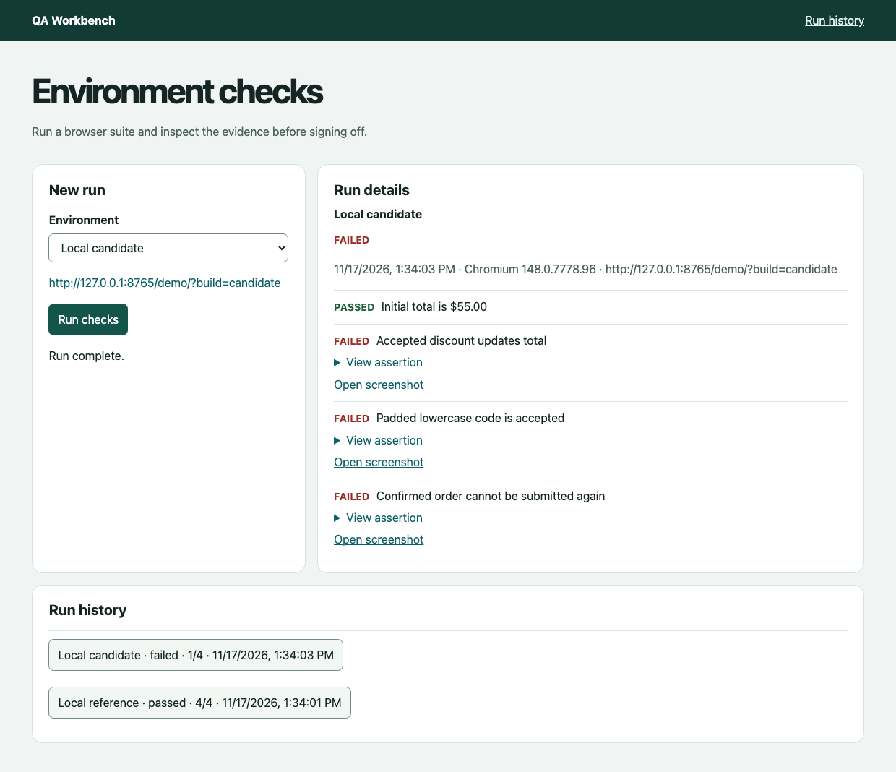

# QA Workbench

A local dashboard for running the same browser checks against multiple environments. It records the result, failed assertions, and screenshots so a tester can compare builds and ask Codex to help draft a defect report.



## Run locally

Use Python 3.12 and Git. From the project folder on macOS or Linux:

```sh
python3.12 -m venv .venv
source .venv/bin/activate
python -m pip install -r requirements.txt
python -m playwright install chromium
python app.py
```

On Windows PowerShell, use `py -3.12 -m venv .venv` and `.\.venv\Scripts\Activate.ps1` for the first two commands. If Linux reports missing browser libraries, run `python -m playwright install --with-deps chromium`.

Open **http://127.0.0.1:8765**. The dashboard and demo share this local server. Stop it with Ctrl+C.

## Try the demo

1. Select **Local reference** and click **Run checks**. Expect four passes.
2. Select **Local candidate** and run again. Expect one pass and three intentionally seeded failures.
3. Open the failed discount-total check. The assertion expects $50.00, but the page shows $55.00. Click **Open screenshot** to see the checkout state.
4. Reopen either result from **Run history**. For manual exploration, click the environment URL and enter `SAVE10` on the demo checkout.

The workbench runs four checkout smoke checks. The companion Checkout QA Case Study is a separate portfolio project with a broader suite, manual cases, and a release decision.

## Test another project

Copy [profiles.example.json](profiles.example.json) to `profiles.local.json`, replace the example values, then reload the dashboard. Give each profile a distinct name.

- **Local app.** Start the app following its own README and set `url` to its running address, such as `http://127.0.0.1:3000/`.
- **GitHub project.** Clone or open its repo separately and start it, or use its staging or PR preview URL. Set `repository` to the GitHub repo and `revision` to the commit SHA or branch label. The workbench records the supplied source context and browser-tests the running URL. Deployment and revision verification stay with the tester.
- **Smoke checks.** Set `suite` to `smoke` and define checks with a `name`, Playwright `selector`, and optional expected `text`. Each check opens a fresh browser context and asserts that its target is visible. The supplied checkout suite is specific to the demo's labels and requirements.

Use dedicated QA environments. The checkout suite clicks a submit button. Run results and screenshots are stored under `data/runs/`. Keep credentials out of URLs and use demo data when sharing evidence with Codex.

## Connect Codex

Follow the [MCP setup and demo prompt](docs/codex.md). For GitHub publishing and interview walkthroughs, see the [portfolio handoff](docs/github.md). The [QA manifesto](MANIFESTO.md) and [agent instructions](AGENTS.md) describe how to work with evidence in this repo.

## Verify changes

Stop the dashboard before running the integration test. It uses the same local port.

```sh
python -m unittest discover -s tests -v
```

GitHub Actions runs the integration check on pushes and pull requests. It drives both dashboard runs in Chromium, opens a screenshot, and queries the local MCP server.
